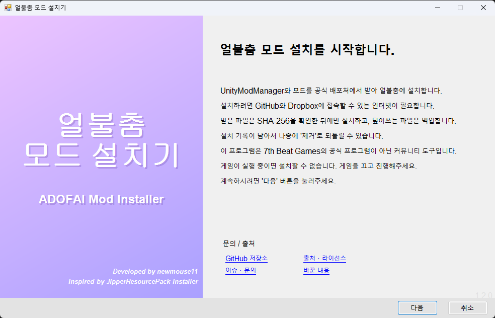
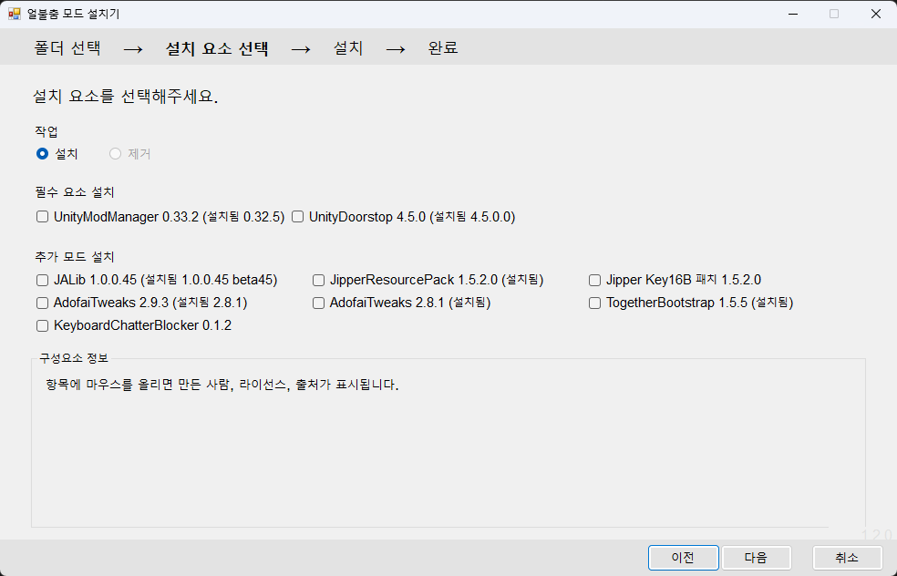
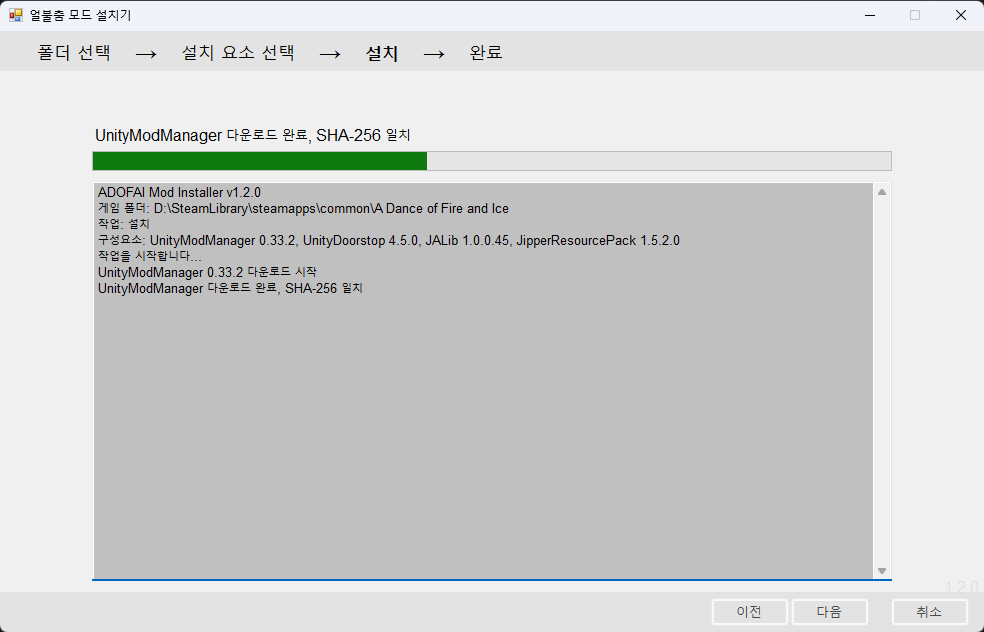
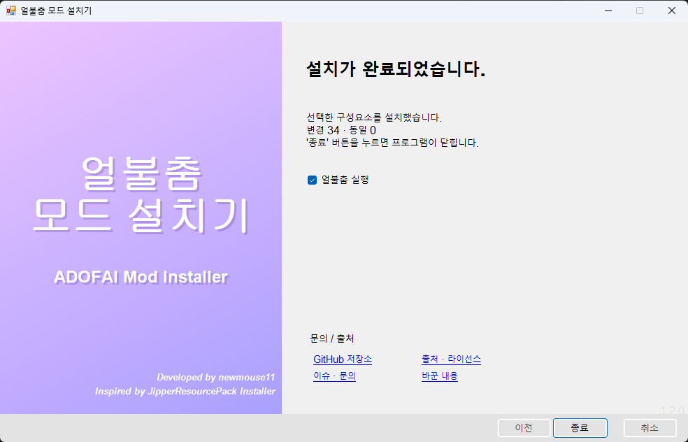

# ADOFAI Mod Installer

[한국어](README.md) · English

An open-source installer that sets up the mod environment (UnityModManager, Doorstop, JALib and mods) for **A Dance of Fire and Ice** in one go. No mod files are bundled: everything is **downloaded from its official source** and installed only if it matches the SHA-256 pinned in the catalog.

It is a five-step wizard in the style of the original JipperResourcePack installer: **Welcome → Game folder → Select components → Install → Finish**. The installer's own screens are **in Korean only**; the labels used below are given as `한국어 (English)`. (Screenshots below are previews.)

| Welcome | Select components |
|---|---|
|  |  |
| **Install** | **Finish** |
|  |  |

## Features

- Finds the game folder from Steam automatically and shows the game build (r number). The folder screen shows a path analysis (game found, UnityModManager / Doorstop status).
- Components that are already installed are shown with their installed version, and required components are pre-selected only when missing. Hovering a component shows its author, license and source link.
- You tick the components you want. Dependencies are switched on automatically, and conflicting components (e.g. AdofaiTweaks 2.9.3 / 2.8.1) cannot be selected together.
- Everything is downloaded and verified **before** the game folder is touched. If applying fails, the changes are rolled back.
- Overwritten files are backed up and an install receipt is written, so **Uninstall** removes only the files in the receipt and restores the backups. You can uninstall everything or only selected components.
- The window cannot be closed while installing or uninstalling (to avoid half-done states), and nothing starts while the game is running. The finish screen can launch the game.
- No administrator rights needed.

## What gets installed

| Component | Version | License | Default |
|---|---|---|---|
| UnityModManager | 0.33.2 | MIT | required |
| UnityDoorstop | 4.5.0 | LGPL-2.1 | required |
| JALib | 1.0.0.45 | BSD-3-Clause | selected |
| JipperResourcePack | 1.5.2.0 | BSD-3-Clause | selected (needs JALib) |
| Jipper Key16B patch | 1.5.2.0 | BSD-3-Clause | (needs Jipper) replaces the official DLL with a modified build |
| AdofaiTweaks | 2.9.3 / 2.8.1 | MIT | |
| TogetherBootstrap | 1.5.5 | unspecified | |
| KeyboardChatterBlocker | 0.1.2 | unspecified | |

Sources and copyright: [NOTICE.md](NOTICE.md). Everything that was changed: [CHANGES.md](CHANGES.md). Both are in Korean.

## How to install

**Requirements:** Windows 10/11, an internet connection, the Steam version of the game. Close the game first. The installer runs on .NET Framework 4.8, which most Windows 10/11 systems already include. (No administrator rights needed.)

1. Download `ADOFAI-Mod-Installer.exe` from the [latest release](https://github.com/newmouse11/Nslookup_-ADOFAI-Mod-Install/releases/latest). For extra safety, compare its hash with `SHA256SUMS.txt` from the same page ([how](#if-a-blue-smartscreen-window-appears)).
2. Run the exe. If a blue window appears, follow [the section below](#if-a-blue-smartscreen-window-appears).
3. **Welcome:** read the notes and press `다음` (Next). It checks your internet connection.
4. **Game folder:** the installer looks for the game in your Steam folders. If it can't find it, or the game is installed elsewhere, press `찾아보기` (Browse) and pick the folder that contains `A Dance of Fire and Ice.exe`. In the `경로 분석` (Path analysis) box on the right, check that the game was found and whether UnityModManager / Doorstop already exist, then press `다음`.
5. **Select components:** choose `설치` (Install) as the action.
   - `필수 요소 설치` (Required components): UnityModManager and UnityDoorstop. If already present they show `(설치됨 …)` (installed) and are pre-selected only when missing.
   - `추가 모드 설치` (Additional mods): tick the mods you want. JALib and JipperResourcePack are selected by default, dependencies switch on automatically, and conflicting components (AdofaiTweaks 2.9.3 / 2.8.1) can't be selected together. Tick `Jipper Key16B 패치` if you want the second 16-key preset (`Key16B`) in the key viewer.
   - Hover over an item to see its author, license and source link in the `구성요소 정보` (Component info) box. Press `다음`.
6. **Install:** download → SHA-256 check → apply. Wait until it finishes; the window can't be closed meanwhile. If something fails, the changes are rolled back.
7. **Finish:** with `얼불춤 실행` (Launch the game) ticked, press `종료` (Exit) to start the game.
8. In the game, press `Ctrl + F10` (UnityModManager's default hotkey) to open the mod window and check that the installed mods are listed.

**Uninstall:** run the installer again and choose `제거` (Uninstall) on the component screen. It is enabled only when this installer has an install record. You can pick `전체 제거` (Remove everything) or `선택한 것만 제거` (Remove selected only). Overwritten files are restored from the backup, and files you edited after installing are left in place.

## Command line

| Option | Description |
|---|---|
| `/silent` | Install without a window (result goes to the log file) |
| `/uninstall` | Remove only the files in the install record and restore backups |
| `/target:"path"` | Game folder (auto-detected if omitted) |
| `/components:a,b` | Component ids to install (defaults if omitted). Required components and dependencies are added automatically |
| `/catalog:"file"` | Use another catalog instead of the built-in one |
| `/list` | Write the catalog's ids to the log |
| `/log:"file"` | Log file (default `%TEMP%\ADOFAI-Mod-Installer.log`) |
| `/selftest` | Security / rollback self-test (no network needed) |
| `/shot:"png" /page:0~4` | Developer screen preview saved as PNG (does no real download or install) |

Exit codes: 0 success, 1 error, 2 bad argument or not a game folder, 3 game is running, 4 download or hash check failed.

## Build

Needs .NET SDK 8 or later. No game files are required.

```powershell
dotnet build src\AdofaiModInstaller.csproj -c Release
```

Output: `src\bin\Release\net48\ADOFAI-Mod-Installer.exe`. Pushing a tag (`v*`) makes GitHub Actions build, self-test and upload the executable and SHA-256 checksums to the release.

## If a blue SmartScreen window appears

The first time you run an exe downloaded in a browser, Windows may show a **blue** "Windows protected your PC" window (Windows SmartScreen). It appears because this installer is not code-signed yet and has few users, so SmartScreen treats it as an unknown file. It does not mean it was judged malicious.

1. Check that your file is the same as the one in the release's `SHA256SUMS.txt`:

   ```powershell
   Get-FileHash .\ADOFAI-Mod-Installer.exe -Algorithm SHA256
   ```

2. If the hashes match, click `More info` → `Run anyway`.
3. To avoid the window altogether, right-click the exe → `Properties` → tick `Unblock` at the bottom → `OK`. (This removes the "downloaded from the internet" mark.)

If the hash differs, or you got the file somewhere other than this repository's releases, don't run it. Don't turn off SmartScreen or your antivirus to get rid of the warning. If your antivirus warns separately, verify the hash the same way and decide for yourself whether to add an exception.

**Code signing:** none yet. On 2026-10-26 we applied to the SignPath Foundation free code signing program for open source, but the application was declined for now because the project is new and lacks community adoption and external mentions. We plan to apply again once it has more users; the policy draft is in [docs/CODE_SIGNING_POLICY.md](docs/CODE_SIGNING_POLICY.md). Until then, use the hash check above.

## FAQ / troubleshooting

<details>
<summary>A blue window ("Windows protected your PC") appears</summary>

That is the SmartScreen warning. Follow [the section above](#if-a-blue-smartscreen-window-appears): check the hash, then click `More info` → `Run anyway`.
</details>

<details>
<summary>My antivirus blocks or deletes the installer or <code>winhttp.dll</code></summary>

The installer is unsigned, so some antivirus products may be suspicious of it while it has few users. UnityDoorstop's `winhttp.dll` loads the mod loader when the game starts, which looks similar to how some malware works, so false positives happen. First check that the SHA-256 of what you downloaded matches the release's `SHA256SUMS.txt`. If it matches and you got it from this repository's release, it is up to you whether to add an exception for the game folder only. Don't switch your antivirus or SmartScreen off completely.
</details>

<details>
<summary>It can't find the game folder / "선택한 폴더는 얼불춤 폴더가 아닙니다" (the selected folder is not the game folder)</summary>

Auto-detection only looks at Steam's install path and Steam library folders. In Steam, right-click the game → `Manage` → `Browse local files`, copy the path from the address bar and choose it with `찾아보기` (Browse). A folder is accepted as the game folder only if it contains both `A Dance of Fire and Ice.exe` and the `A Dance of Fire and Ice_Data` folder. Non-Steam installs should work the same way by picking the folder, but that has not been tested.
</details>

<details>
<summary>"게임이 실행 중입니다" (the game is running)</summary>

Files are locked while the game runs, so nothing can be installed. Close the game and press `다음` again. If you see no window, check Task Manager for a leftover `A Dance of Fire and Ice` process.
</details>

<details>
<summary>Download or hash errors</summary>

- Check your internet connection and that GitHub and Dropbox are reachable. School or company networks may block them.
- A "hash mismatch" means the downloaded file differs from what the catalog pins. **Nothing is installed in that case, and that is the intended behavior.** UnityModManager is only distributed through a Dropbox link, so if that file changes this can happen; please tell us in an [issue](https://github.com/newmouse11/Nslookup_-ADOFAI-Mod-Install/issues).
</details>

<details>
<summary>Installation finished but the mod window doesn't open in the game</summary>

1. Close the game completely and start it again.
2. Press `Ctrl + F10` in the game (or your custom hotkey if you changed it).
3. Check that `winhttp.dll` and `doorstop_config.ini` exist in the game folder. If not, your antivirus may have removed them.
4. Run the installer again; missing required components are selected automatically.

If it still doesn't work, post the log and the game build (r number) in an [issue](https://github.com/newmouse11/Nslookup_-ADOFAI-Mod-Install/issues). Note that we have not yet confirmed that mods installed by this installer actually load in the real game (see [Verification status](#verification-status)).
</details>

<details>
<summary>The game updated and my mods are gone / the path analysis shows a yellow warning</summary>

Run the installer again. The path analysis message "UnityModManager가 Assembly 방식으로 설치되어 있습니다" means UnityModManager was installed in the "Assembly" way, which must be reinstalled after every game update. "Doorstop이 구버전입니다" means your Doorstop is outdated; reinstall UnityDoorstop on the component screen.
</details>

<details>
<summary>I already installed mods another way (official Jipper installer, manual install)</summary>

Installed components are shown with their installed version as `(설치됨 …)`, and required components are pre-selected only when missing. Overwritten files are backed up under `<game folder>\ADOFAI-Mod-Installer\backup\`, and `제거` (Uninstall) removes only the files this installer installed and restores the backups. For big changes it is still wise to copy your `Mods` folder first.
</details>

<details>
<summary>It failed halfway. Where is the log?</summary>

If an error happens while applying, the changes are rolled back automatically. Press `로그 보기` (View log) on the finish screen or open `%TEMP%\ADOFAI-Mod-Installer.log`. The log contains the game folder path, which may include your Windows user name, so remove it before posting in an issue.
</details>

<details>
<summary>"Access denied" style errors</summary>

Common causes: the game is still running, or an antivirus folder protection (anti-ransomware, Windows `Controlled folder access`, etc.) is blocking writes to the game folder. Allow the installer in that protection, or turn it off briefly, then try again. The installer does not ask for administrator rights.
</details>

<details>
<summary>What is the Key16B patch? My key viewer looks wrong</summary>

It is a modified build of the JipperResourcePack key viewer that adds `Key16B` (a second 16-key preset) to the style row. Tick `Jipper Key16B 패치` to install it ([details](#key16b-patch)). If JALib's auto-update overwrites it with the official Jipper and the key viewer breaks, set `KeyViewerStyle` to `1` (Key16) in `Mods\JipperResourcePack\Settings.json`, or reinstall the patch with the installer.
</details>

<details>
<summary>I want to add more mods</summary>

See [Editing the catalog](#editing-the-catalog-adding-components). Installed mods run unrestricted code inside the game, so add only mods from sources you trust.
</details>

<details>
<summary>Is it official? Does it work on Mac or Linux?</summary>

It is a community tool, not an official program of 7th Beat Games. It is Windows-only; other operating systems are not supported.
</details>

## Editing the catalog (adding components)

Add an entry to `src/catalog.json` and rebuild, or point to another file with `/catalog:`.

| Field | Description |
|---|---|
| `id`, `name`, `version`, `author`, `license`, `homepage`, `note` | Display and source info |
| `url`, `sha256`, `size` | Download address (https) and the exact hash and byte count. If any one differs, installation stops |
| `kind` | `umm` · `doorstop` · `mod` (installs into `Mods\<dir>`) · `file` (a single file at `path`) |
| `dir`, `path` | Folder name for `mod`, path relative to the game folder for `file` |
| `required`, `defaultOn` | Required / selected by default |
| `requires`, `conflicts` | Ids this one depends on / conflicts with |

Compute the hash and size with `tools\catalog-entry.ps1 -File downloaded.zip -Url ... -Id ... -Name ... -Version ...`. For GitHub releases, also compare against the API value (`assets[].digest`).

A `mod` zip must have `Info.json` at its root or inside a single top-level folder.

## Verification status

- The self-test (`/selftest`) passes all 40 checks: catalog validation, path-escape rejection, zip structure handling, rollback and uninstall (including partial uninstall), hash and size checks, handling of identical paths, and detection of installed components.
- The wizard was driven with real UI automation (click-through) on a fake game folder: Welcome → folder → select → install → finish → exit (install), and uninstall → confirm → finish → exit (uninstall), end to end.
- Key16B patch component: a fresh install and a replacement install over the official Jipper both put the DLL in exactly, and uninstalling leaves no file behind.
- Installing from the official sources into a fake game folder that only has a placeholder executable, reinstalling, uninstalling, backing up and restoring existing files, and rejecting a hash mismatch were all tested. The installed `winhttp.dll`, `doorstop_config.ini` and `Config.xml` were byte-identical to the files of a working setup.
- The GitHub Actions tag builds (v1.2.0, v1.2.1) succeeded through build, self-test and release upload, and the hash and self-test of the exe downloaded from the release were checked.
- **Not verified:** that the installed mods actually **load in the real game**.
- UnityModManager is installed as the file the distributor currently serves (0.33.2). It may differ from the combination that was confirmed with the older 0.32.x.

## Key16B patch

A modified build that adds a `Key16B` button (a second 16-key preset with its own saved key layout) to the style row of the JipperResourcePack key viewer. Tick `Jipper Key16B 패치` in the installer to replace the official DLL with this build; uninstalling reverts it.

| Location | Content |
|---|---|
| `dist/jipper-key16b/` | The modified DLL (`JipperResourcePack-1.5.2.0-Key16B.dll`) and the license notice |
| `patches/` | The feature change (`jipper-key16b.patch`) and the build adjustments (`jipper-local-build-tweaks.patch`) |
| `tools/jipper-build/` | Tools and steps to rebuild it yourself |

It is not an official build and works with 1.5.2.0 only. All changes and verification results are in [CHANGES.md](CHANGES.md) (Korean).

## Repository layout

| Path | Content |
|---|---|
| `src/` | Installer source and the built-in catalog (`catalog.json`) |
| `dist/` | The Key16B modified DLL |
| `patches/`, `tools/` | Patches, the catalog-entry script, DLL rebuild tools |
| `README.md`, `README.en.md` | Korean / English readme |
| `NOTICE.md`, `CHANGES.md`, `SECURITY.md`, `LICENSE` | Sources and copyright, changes, security, license |
| `docs/` | Screenshots, code signing policy |

## License

[MIT](LICENSE) © 2026 newmouse11. The patches follow the original (BSD-3-Clause).
