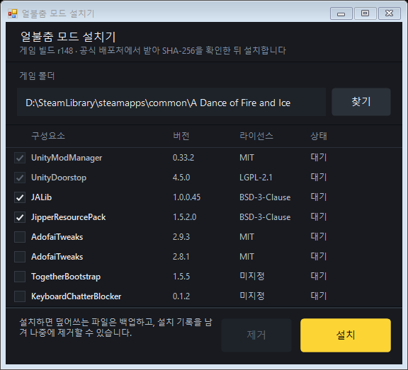

# ADOFAI Mod Installer

얼불춤(A Dance of Fire and Ice) 모드 환경(UnityModManager, Doorstop, JALib, 모드)을 한 번에 설치하는 오픈소스 설치기입니다. 파일은 설치기에 넣어 두지 않고 **공식 배포처에서 직접 받아**, 카탈로그에 적힌 SHA-256과 일치할 때만 설치합니다.



## 기능

- 스팀에서 게임 폴더를 자동으로 찾고, 게임 빌드(r번호)를 보여줍니다.
- 구성요소를 체크해서 고릅니다. 필요한 것(의존)은 자동으로 켜지고, 서로 충돌하는 것(예: AdofaiTweaks 2.9.3 / 2.8.1)은 함께 켜지지 않습니다.
- 전부 내려받아 검증한 **뒤에** 게임 폴더를 바꿉니다. 적용 중 실패하면 되돌립니다.
- 덮어쓰는 파일은 백업하고, 설치 기록(영수증)을 남겨서 **제거**하면 기록에 있는 파일만 지우고 백업을 복원합니다.
- 관리자 권한이 필요 없습니다.

## 설치되는 것

| 구성요소 | 버전 | 라이선스 | 기본 |
|---|---|---|---|
| UnityModManager | 0.33.2 | MIT | 필수 |
| UnityDoorstop | 4.5.0 | LGPL-2.1 | 필수 |
| JALib | 1.0.0.45 | BSD-3-Clause | 선택됨 |
| JipperResourcePack | 1.5.2.0 | BSD-3-Clause | 선택됨 (JALib 필요) |
| AdofaiTweaks | 2.9.3 / 2.8.1 | MIT | |
| TogetherBootstrap | 1.5.5 | 미지정 | |
| KeyboardChatterBlocker | 0.1.2 | 미지정 | |

출처와 저작권은 [NOTICE.md](NOTICE.md), 바꾼 내용은 [CHANGES.md](CHANGES.md)를 보세요.

## 사용

`ADOFAI-Mod-Installer.exe`를 실행하고 `설치`를 누릅니다. 게임은 꺼 두세요.

명령줄 옵션:

| 옵션 | 설명 |
|---|---|
| `/silent` | 화면 없이 설치 (결과는 로그 파일에 기록) |
| `/uninstall` | 설치 기록에 있는 파일만 제거하고 백업을 복원 |
| `/target:"경로"` | 게임 폴더 (생략하면 자동 탐색) |
| `/components:a,b` | 설치할 id (생략하면 기본 선택). 필수·의존 항목은 자동 추가 |
| `/catalog:"파일"` | 내장 카탈로그 대신 쓸 카탈로그 |
| `/list` | 카탈로그의 id 목록을 로그로 출력 |
| `/log:"파일"` | 로그 파일 (기본 `%TEMP%\ADOFAI-Mod-Installer.log`) |
| `/selftest` | 보안·롤백 자체 검사 (네트워크 불필요) |

종료 코드: 0 성공, 1 오류, 2 잘못된 인자 또는 게임 폴더 아님, 3 게임 실행 중, 4 다운로드·해시 검증 실패.

## 빌드

.NET SDK 8 이상이 필요합니다. 게임 파일은 필요 없습니다.

```powershell
dotnet build src\AdofaiModInstaller.csproj -c Release
```

결과: `src\bin\Release\net48\ADOFAI-Mod-Installer.exe`. 태그(`v*`)를 푸시하면 GitHub Actions가 빌드·자체 검사를 거쳐 실행 파일과 SHA-256 체크섬을 릴리스에 올립니다.

## 카탈로그 수정 (구성요소 추가)

`src/catalog.json`에 항목을 추가하고 다시 빌드하거나, `/catalog:`로 다른 파일을 지정합니다.

| 필드 | 설명 |
|---|---|
| `id`, `name`, `version`, `author`, `license`, `homepage`, `note` | 표시와 출처 정보 |
| `url`, `sha256`, `size` | 받을 주소(https)와 정확한 해시·바이트 수. 하나라도 다르면 설치 중단 |
| `kind` | `umm` · `doorstop` · `mod`(`Mods\<dir>`에 설치) · `file`(`path`에 파일 하나) |
| `dir`, `path` | `mod`의 폴더 이름, `file`의 게임 폴더 기준 상대 경로 |
| `required`, `defaultOn` | 필수 / 기본 선택 |
| `requires`, `conflicts` | 의존 / 충돌하는 id |

해시와 크기는 `tools\catalog-entry.ps1 -File 받은파일.zip -Url ... -Id ... -Name ... -Version ...`으로 계산할 수 있습니다. GitHub 릴리스는 API(`assets[].digest`)의 값과도 대조하세요.

`mod`의 zip은 `Info.json`이 루트에 있거나, 최상위 폴더 하나 안에 있어야 합니다.

## 검증 상태

- 자체 검사(`/selftest`) 30개 통과: 카탈로그 검증, 경로 이탈 거부, zip 구조 처리, 롤백·제거, 해시·크기 검증.
- 실행 파일 자리표시자만 있는 가짜 게임 폴더에 공식 배포처에서 실제로 받아 설치, 재설치, 제거, 기존 파일 백업·복원, 해시 불일치 거부를 확인했습니다. 설치된 `winhttp.dll`, `doorstop_config.ini`, `Config.xml`은 실제로 동작 중인 환경의 파일과 바이트 단위로 같았습니다.
- 확인하지 못한 것: 설치된 모드가 **실제 게임에서 로드되는지**, 그리고 GitHub Actions 워크플로 실행.
- UnityModManager는 배포처의 파일(현재 0.33.2)을 그대로 설치합니다. 이전 버전(0.32.x)에서 확인된 조합과 다를 수 있습니다.

## Key16B 패치

JipperResourcePack 키뷰어에 두 번째 16키 프리셋을 추가하는 패치가 `patches/jipper-key16b.patch`에 있습니다. 적용 방법과 내용은 [CHANGES.md](CHANGES.md)를 보세요. 패치로 빌드한 DLL은 이 저장소에 포함하지 않았습니다. 릴리스로 올린다면 `kind: file` 항목으로 카탈로그에 추가할 수 있습니다.

## 라이선스

[MIT](LICENSE) © 2026 newmouse11. 패치는 원본(BSD-3-Clause)을 따릅니다.
